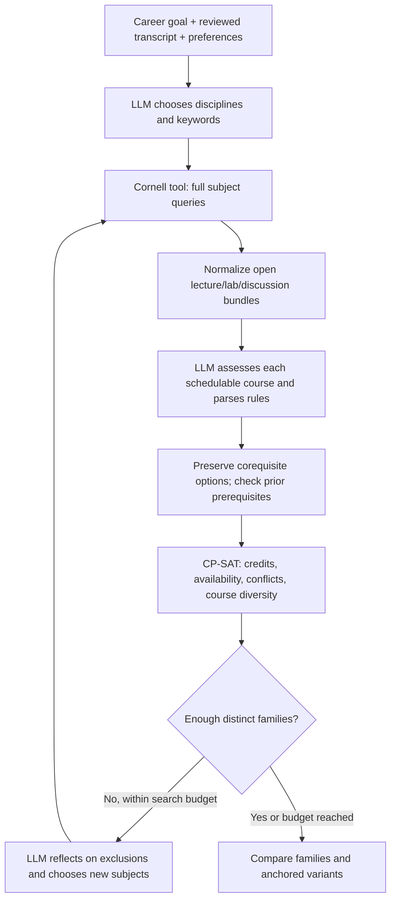

# Course Compass

Career-driven Cornell course discovery and scheduling, with a Python optimizer and expandable plan families.

This is a working full-stack web application. The frontend uses HTML, CSS, and JavaScript. FastAPI serves both the website and the Python API, so deployment requires only one service. OpenAI plans course searches, scores course relevance, and structures enrollment rules; OR-Tools CP-SAT checks constraints and generates feasible schedules.

## Run locally

Requires Python 3.12. On macOS/Linux:

```bash
bash start.sh
```

Open <http://127.0.0.1:8765>. The first start creates `.venv` and installs dependencies. Alternatively:

```bash
python3 -m venv .venv
.venv/bin/python -m pip install -r requirements.txt
.venv/bin/python -m uvicorn app.main:app --host 127.0.0.1 --port 8765 --no-access-log
```

Click **Explore a demo** to use 308 actual Cornell Spring 2027 records from COMM, CS, ECON, INFO and STSCI. The sample transcript is fictional. Demo scoring is deterministic and intended to exercise the real optimizer and UI; it does not call an LLM. Other careers and disciplines use live mode.

For the live agent, enter your goal, choose a term and academic level, enter your OpenAI API key, review completed courses, then click **Find my course plans**. Manual entry needs no transcript extraction call. PDF/TXT/CSV extraction needs the key. Text-based PDFs are supported; scanned PDFs need OCR before upload.

## What the agent does



This is a bounded agentic controller, not an unconstrained chatbot. The LLM selects retrieval actions through structured decisions. Python executes only allowlisted Cornell calls and optimization. Infeasible or insufficiently diverse results are fed back to the LLM for one additional search round. The UI exposes decisions, queries, counts and solver results, not hidden model reasoning. This implementation uses OpenAI structured outputs rather than the API's `tool_calls` wire format; the controller executes the selected actions.

| Module | Responsibility |
| --- | --- |
| `app/agent.py` | OpenAI structured planning/scoring, transcript extraction, reflection loop, labeled demo |
| `app/catalog.py` | Cornell client, 1.05-second request spacing, conditional cache, section normalization |
| `app/models.py` | Validated requests, transcript grades, AND/OR requirement representation |
| `app/optimizer.py` | Eligibility, CP-SAT, family separation, variants, post-solve validation |
| `app/main.py` | FastAPI routes, NDJSON progress stream, upload handling, sanitized errors |
| `static/` | Responsive English website, editable transcript, comparison, dated timetable, JSON export |

## Retrieval and scope

Live mode can choose from Cornell's full public subject list, not just the five demo disciplines. It fetches each selected subject without `q`: verified API behavior shows that keyword search can miss words that occur only in descriptions. Keywords guide semantic scoring rather than server-side filtering.

The returned set is exhaustive **within each fetched subject response**, not across the whole university. Hard campus, career and schedule filtering precedes scoring. Each remaining schedulable candidate is assessed individually in batches of 12. More than 400 new schedulable courses in one round stops the run with an instruction to narrow the search. The optimizer retains up to 45 eligible courses, prioritizing must-takes and corequisites. A course has at most 80 section bundles. Search is limited to two rounds, normally at most 10 discovery subjects plus bounded corequisite expansion, and 10 minutes. Missing dependencies fail closed. The UI exposes coverage and exclusions.

Only open sections with known dates/times and fixed credits are considered. Required components are bundled within an enrollment group. Variable-credit, TBA/asynchronous, unverified linked-section restrictions, and uncertain requirements are excluded or sent for review. Cross-listings share one course decision. Forbidden-overlap text is conservatively checked; complex exceptions may need manual review.

Ordinary prerequisites require a previously completed passing course, with a minimum grade where stated. In-progress classes never satisfy these prerequisites. Only explicit corequisites can be selected concurrently. Blank prerequisite fields are identified as undocumented, not a guarantee of access. Degree audits, transfer equivalence, walking times, enrollment submission, and seat reservations are outside this version.

## Families and variants

- The first anchor maximizes career relevance, then prefers fewer campus days and less early class time. Subsequent anchors emphasize foundations and disciplinary breadth.
- Each anchor retains at least 85% of the best-found career score. For four courses, two courses must be replaced between family anchors. For two-course plans, one must change.
- Each family fixes its highest-priority `n−1` courses as a core. Variants change section times or at most one elective. They are compared to the anchor, not clustered through a chain of increasingly different plans.
- Identical timetable alternatives are collapsed; elective variants cannot duplicate another family's anchor or elective variant. Narrow constraints may yield fewer than three families or a single variant.
- Solver `OPTIMAL`/`FEASIBLE`/`INFEASIBLE`/`UNKNOWN` states are reported accurately for the bounded model and stated objective. The match score is a model/scorer rating, not a probability of career success.

## Tests and evaluation

```bash
.venv/bin/python -m pip install -r requirements-dev.txt
.venv/bin/python -m pytest -q
.venv/bin/python evaluate.py
```

Tests exercise prerequisites versus concurrent enrollment, grade minima, AND/OR rules, mandatory components, dates and weekdays, credits, forbidden overlaps, cross-listings, family diversity, core preservation, public-data caching, SDK structured-output requests, sanitized credential errors, reflection, and a real-roster demo.

`evaluation-results.json` contains reproducible runs against the actual Cornell snapshot: baseline, missing programming prerequisite, impossible credits, and blocked weekdays. These measure solver and workflow behavior, **not live LLM recommendation accuracy**. OpenAI transport is tested with a mock response; a live paid-key run and human relevance/eligibility review remain necessary before claiming LLM effectiveness in the assignment.

For a classroom evaluation, run 5–10 career profiles with a key and compare: valid-plan rate, documented constraint violations, relevance rated by two reviewers, subject coverage, family distance, latency, token usage, and baseline top-score recommendations without optimization. Report observed results rather than treating mock tests as model-quality evidence.

## Deploy one Python service

Use the included `render.yaml` as a Render Blueprint, or create a Render Python Web Service from this folder as repository root:

- Build: `pip install -r requirements.txt`
- Start: `uvicorn app.main:app --host 0.0.0.0 --port $PORT --workers 1 --no-access-log`
- Health: `/api/health`
- Python: 3.12

No shared OpenAI key is required in hosting environment variables: users bring their own. Render account/repository connection and final deployment have not been performed. A free service can sleep; warm it before presenting. The Dockerfile is an alternative for a Linux host supporting native Python wheels. Docker execution itself has not been verified here.

Run **one worker / one instance** to preserve Cornell's process-wide request spacing. Multi-instance deployment needs a shared rate limiter. Configure HTTPS at the hosting layer. No browser CORS bridge or separate frontend host is needed.

## Data handling

API keys exist in browser memory and request-scoped server memory; they are not saved to localStorage, files, a database, or application logs. The website sends the key to its own backend, which uses it only with the fixed OpenAI endpoint. Transcript extraction sends transcript text to OpenAI; planning sends the goal and course/grade list. Provider retention policies apply. Uploads and extracted private data are processed in memory. Only public Cornell responses are cached, in memory for five minutes with Last-Modified revalidation. HTTP responses use `no-store`; error messages exclude provider request details. Exports include the chosen plan and activity trace, not the key or raw transcript.

## Sources

- [Cornell roster API](https://classes.cornell.edu/content/SP27/api-details)
- [Cornell Spring 2027 roster](https://classes.cornell.edu/browse/roster/SP27)
- [OpenAI structured outputs](https://developers.openai.com/api/docs/guides/structured-outputs)
- [OR-Tools CP-SAT](https://developers.google.com/optimization/cp/cp_solver)
- [Render FastAPI deployment](https://render.com/docs/deploy-fastapi)

Cornell course text remains attributable to Cornell. The bundled JSON is a public-roster snapshot with retrieval timestamp and source provenance. It is not a current seat-availability guarantee.
